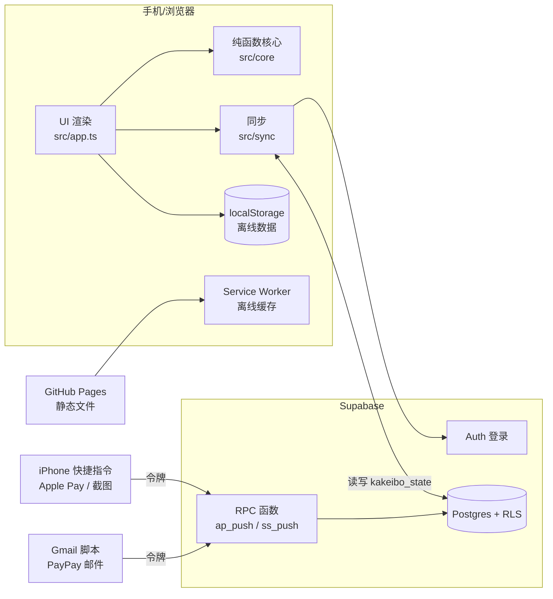
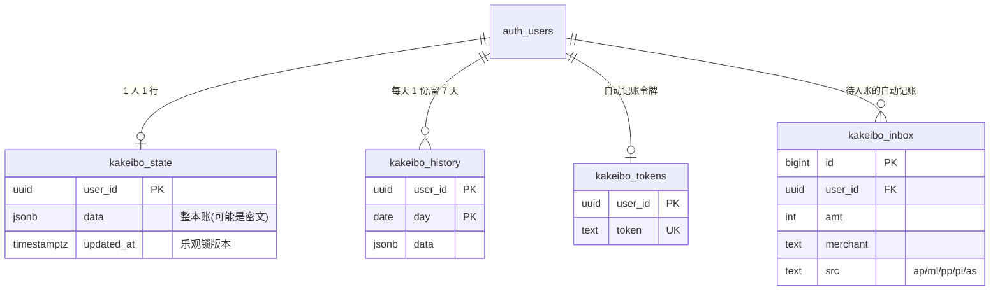
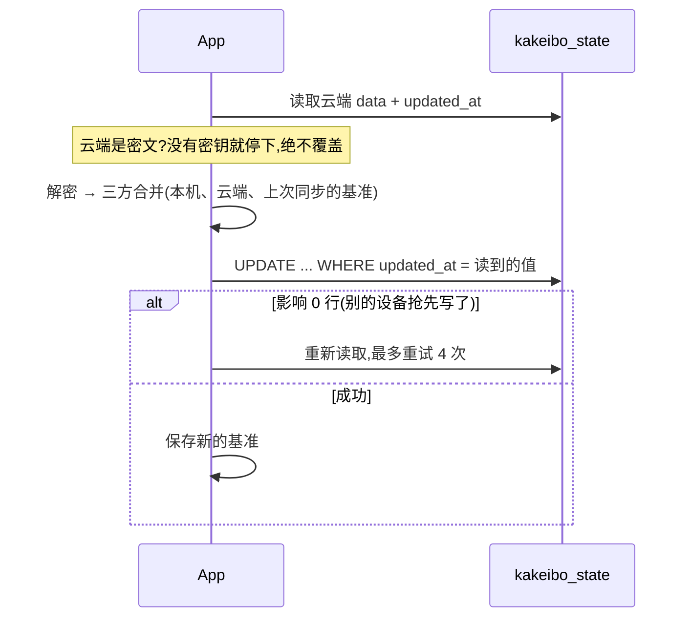
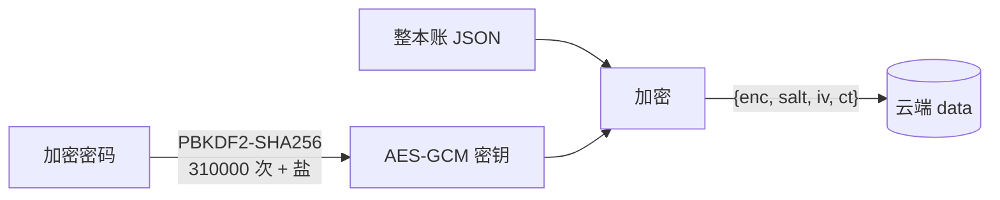
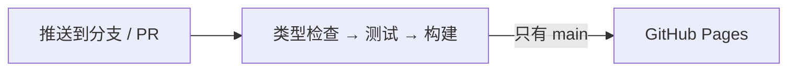

# 架构说明

记账本是一个**没有自建服务器**的 PWA:前端静态文件放在 GitHub Pages,数据和账号交给 Supabase。
数据默认只保存在本机(localStorage),登录后才同步到云端;开启端到端加密后,云端只存密文。

## 1. 总览

## 2. 代码分层

| 层 | 路径 | 特点 |
|---|---|---|
| 纯函数核心 | `src/core/ledger.ts` `dedupe.ts` `rakuten.ts` | 不碰 DOM、不碰全局变量,输入输出明确,有单元测试 |
| 同步与加密 | `src/sync/merge.ts` `crypto.ts` | 三方合并、PBKDF2 + AES-GCM,有单元测试 |
| 多语言 | `src/i18n/translate.ts` | 中 / 英 / 日词典和翻译引擎 |
| UI 与状态 | `src/app.ts` | 模板字符串渲染 + 全局状态;对核心只留一行包装(如 `const flow=()=>flowOf(LD())`) |

拆分原则:每拆出一块,都和原代码**对拍**(随机输入比较新旧输出,十万次级别),并对界面做逐像素截图比较,确保行为不变。

## 3. 数据库(Supabase,见 `supabase/schema.sql`)

- **kakeibo_state**:整本账存成一个 jsonb。简单,适合个人记账的数据量;代价是同步以整本为单位,所以需要合并逻辑。
- **kakeibo_history**:触发器 `kakeibo_keep_history` 在每次更新前,把旧数据按日期存一份(日本时间),只保留最近 7 天。
- **kakeibo_tokens / kakeibo_inbox**:自动记账。快捷指令不登录,用令牌调用 `ap_push` / `ss_push`,数据先进收件箱,App 同步时取走并删除。

### 行级权限(RLS)

四张表都开启 RLS,策略统一是 `auth.uid() = user_id`:只能读写自己的行。
收件箱只开放 select / delete,**不开放 insert**——写入只能经过 `security definer` 的 RPC 函数,函数里会:

1. 用令牌换 user_id,令牌错误直接拒绝;
2. 限流(24 小时内最多 300 条);
3. 校验金额范围、时间范围,截断字符串长度。

前端代码里的 `SUPA_KEY` 是 publishable key,本来就是公开的,安全靠 RLS 保证。

## 4. 同步流程

- **三方合并**(`src/sync/merge.ts`):用"上次同步的状态"作基准,分别算出本机和云端各自改了什么,再合起来。两台设备同时记账、一台删除一台修改,都不会丢数据。
- **乐观锁**:用 `updated_at` 当版本号,写入时带上条件;被别人抢先就重新合并,而不是覆盖。

## 5. 端到端加密

- 密码只在本机,用 PBKDF2 派生密钥,每次加密用新的随机 IV。
- 开启加密后,云端 `kakeibo_state` 和备份里只有密文;**忘记密码无法找回**。
- 开启时会删除备份里加密前的明文历史。
- 限制:自动记账收件箱的内容(金额、店名)在进入账本前是明文,因为快捷指令没有密钥。

## 6. 构建与发布

构建时 `vite.config.ts` 里的插件把带哈希的资源清单和构建号写进 `sw.js`,所以每次发布都会让旧缓存失效,用户拿到新版本。
CSS 压缩用 esbuild(默认的 lightningcss 会加字体回退,改变渲染)。

## 7. 取舍与已知限制

- 整本账一个 jsonb:实现简单,但数据量很大时同步会变慢;如果以后要做,可以按月拆分。
- `src/app.ts` 仍有约 1400 行 UI 代码,暂不做类型检查(`@ts-nocheck`),计划逐步拆分。
- 没有端到端(浏览器)自动测试;UI 行为靠截图对比脚本人工跑。
